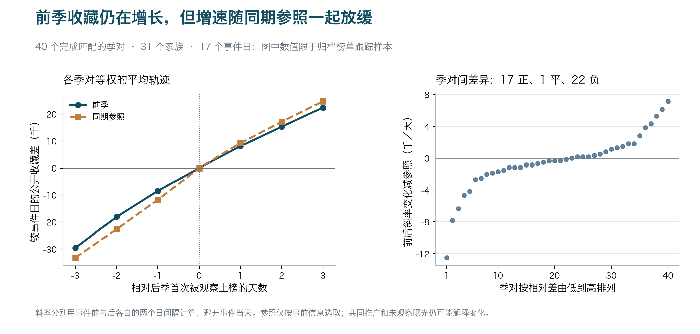

# 红果短剧 FYP 选题决策手册

**研究范围**　截至 2026 年 11 月 19 日，以红果平台内部的作品、公开页面和榜单档案为研究对象。此稿用于选题和讨论。案例数字来自本项目实测。以下标为「已核」的事实对应原始材料，「推断」指基于资料的研究判断，「待验」指会改变立项决定的假设。所有数量门槛是为本科项目设置的可操作标准，另需按估计精度决定最终样本。

**阅读顺序**　先看下表比较六条路线，再看第五节两个实测试验。八张研究卡与七维评分在[候选题决策表](八个候选题与评分.md)，三条推荐的四周门槛在第六节。

## 一、红果研究方向地图

| 方向 | 真正有分歧的问题和可能使用结果的人 | BA / IS 理论与红果机制 | 文献做到哪里 | 可用数据、研究类型和本科难度 |
|---|---|---|---|---|
| A 内容设计 | 看不懂续季的人可能需要补前季，也可能因为进入门槛而退出。片段里观众究竟在猜答案，还是已知答案后提示他人？编排者面对两种不同的信息需求。 | 叙事理解、信息缺口、认知负荷。编号季可单独成为榜单作品；同一短集内可对齐情节揭示与弹幕播放位置。 | 悬念实验、54剧反转与情感分析已存在，粗分“反转多不多”很难再贡献。 | 季简介有覆盖，集内解答点需另行人工标记。描述性同剧比较中等，招募实验中高。[Schibler 等](https://doi.org/10.1080/15213269.2023.2219456) · [胡岑岑、朱格](https://qqcm.cbpt.cnki.net/portal/journal/portal/client/paper/6d2c638c034d262cef83d73e92ff11c6) |
| B 参与行为 | 两部剧同获高分，一部热评说清是否慢热、是否适合喜欢某类关系的观众，另一部反复表达支持。详情页有多大机会提供前一种信息？ | Product fit uncertainty、信息诊断性。红果公开展示整剧热评预览，分集评论与弹幕是另一种表达场景。 | 展示评论与选择已有研究；微短剧创作者使用反馈已有访谈。仍可量化与本剧官方说明配对后的信息增量。 | 30个详情页预览可配对。测量难度中，实际选择效果需实验。[Hong & Pavlou](https://doi.org/10.1287/isre.2014.0520) · [Vana & Lambrecht](https://doi.org/10.1287/mksc.2020.1278) |
| C 平台分发 | 一个系列得到新入口时，旧季也受关注，还是同类作品整个时段都在减速？哪种分发可以观察到？ | 注意力配置、产品发现、选择性曝光。分类榜、综合榜与个性化推荐入口共存。 | 红果档案论文已研究跨榜与进出榜；平台团队已有排序实验。单凭公开榜单再现算法的空间很小。 | 四榜轨迹能研究已记录的公共可见性。个人推荐曝光量、购买渠道不可回溯。测量中等，榜单增量曝光因果高难。[Ouyang](https://arxiv.org/abs/2611.19351) · [DramaQA 作者全文](https://www.jiangtongli.me/uploads/papers/2026-WWW-DramaQA.pdf) |
| D 供给与 IP | 平台把两季连成一个系列，观众是否还需前作知识？官方标明原著时，它是否也让作者和作品可被准确辨认？ | 互补品、品牌延伸、跨媒体叙事、信息溯源。红果具有分季组与网文关联字段，文字简介、字段与片名提供不同层次的线索。 | 新作带动旧作在音乐、游戏中已有直接先例，网文微短剧已有案例分析。 | 用同家族和同一作品跨展示位置核对。预算、厂牌和知名原著影响哪些作品获改编与推广；估计改编回报高难，做归属测量中等。[Gross & Savelle](https://papers.ssrn.com/sol3/papers.cfm?abstract_id=5119571) · [Bao](https://hdl.handle.net/10292/21053) |
| E 生命周期与运营 | 续季首见前后，前季的收藏增长如何变化？一部作品出榜后多久重新出现，与漏抓能否区分？ | 产品生命周期、目录运营、有限注意力。作品日与榜日为两个观测层次，同一作品离开一个榜后仍可能有详情快照。 | 流媒体已有真实排播实验，但排播、出现于榜单和披露更新计划是三种不同事件。 | 可做事件轨迹、重现档案。更新可能是对先前热度的回应，完结因果研究高难。[Godinho de Matos 等](https://doi.org/10.1287/mksc.2023.0106) |
| F 测量、预测与决策 | 运营人员选择明日复核哪些剧时，更多变量能否稳定改变复核名单？更低频的榜单存档会漏掉哪些持续上榜片段？ | 信息价值、决策损失、观测误差。红果公开榜只给前100名，部分公开累计收藏以粗粒度变化。 | 已有红果公开档案。新意来自与具体用途对应的遗漏、误报和增量，而非模型复杂程度。 | 预测有时间外基线；降频审计可用完整日榜模拟。只推断对指定榜单的观测表现，本科易至中。[Ouyang](https://arxiv.org/abs/2611.19351) · [Shmueli](https://doi.org/10.1214/10-STS330) |

### 我会怎样判断题目是否值得立项

先写出两种都讲得通、对同一观测量却有不同预期的解释。再指定一个使用者、一项会随证据改变的判断、一个能实际取得的分母，以及看到什么会放弃这个解释。例如“连续故事会带动补前季”与“续季抢走有限注意力”都讲得通。两季总收藏上升仍无法区分它们，合适的比较量是前季日均收藏净增相对自身过去和同日参照的变化。即使这个量为负，共同营销、生命周期错配仍然可以解释它。另一种本科贡献是衡量某类信息到底在多少页面可见；若人工无法一致识别该信息，应主动改变问题。

## 二、现有数据实际能支撑到哪里

| 证据单位 | 已核到的覆盖 | 对设计的直接影响 |
|---|---:|---|
| 历史目录 / 作品日 / 榜单席位 | 1,388 个目录 ID，22,901 个作品日，14,398 个榜单席位日，10月13日至11月17日共36天。只有49个 ID 每天都有作品快照；10月31日榜单不完整。 | 这是上榜抓取及继续追踪形成的目录。榜单以日期＋榜种＋名次校验完整。缺行、已出榜、零收藏分别编码。 |
| 内容资料 | 历史目录中28个 ID 有从简介抽取的原著作品名、24个有原著作者、321个有演员字段、1,380个有简介。5部较完整的分集样本共1,395条记录。 | 原著字段缺失不能赋“原创”；演员字段不能充当预算；5部中的大量集仍是5个作品簇，跨剧有效样本很小。 |
| 用户反应 | 旧样本整剧预览45条、分集预览75条、首页弹幕46条。此次另行冻结30部作品，全部成功取得详情页内嵌热评，每部9条，共270条。 | 整剧、分集、播放位置分开建表。一个人的多条评论也可重复出现；缺少观看者分母，无法算观众参与率。 |
| 时间与状态 | 36个源快照中，12部有状态码变化，包括8次从1回到0；93部的集数出现相邻日变化，含67次下降。 | 首次采集、页面首次可见、预告、真实可播放、更新、榜单首见分别记录。状态码不能直接定义一次性完结。 |
| 分季与今日新快照 | 63个通过七天窗口的候选全部在同组季详情上获得确认。11月19日另采当日四榜各100席，20个页面，保留来源日期与哈希。 | 新快照单列，11月18日没有据此补齐。网站字段与 SDK 对同一概念的数值精度需逐项核对。 |

数据口径和原始字段参见[历史文件与哈希](../hongguo_research_review_2026-11-19/evidence/data_audit_recheck.json)、[原始状态记录复核](../hongguo_research_review_2026-11-19/evidence/extra_scope_checks.md)、[样本冻结表](reviews/frozen_30.csv)、[新快照清单](prospective/20261119T152602/manifest.json)。

## 三、红果的流量能观察到什么

| 流量来源 | 已核事实及可能影响 | 单剧识别边界 |
|---|---|---|
| 站内个性化推荐 | 官方披露依据浏览、收藏等行为分析偏好并调整推荐。点击和收藏既可能由推荐产生，也可能进入后续分发反馈。 | 没有用户级展示、候选池、策略版本或曝光概率。公开综合热度由多种行为形成。[隐私政策](https://reading.snssdk.com/wap-hongguo/dr-privacy-v3.html) · [榜单口径](https://hongguoduanju.com/rank/hot-drama) |
| 平台运营扶持 | 果燃计划说明精品推广可提供更多算法推荐曝光。创作者业务资料也提供红果广告资源对接入口。 | 计划存在不能推出某剧入选或支持发生在特定日。面向真人剧的规则不能直接套给本次分季漫剧样本。[果燃计划手册](https://support.oceanengine.com/support/content/206627?spaceId=467) · [版权方合作说明](https://support.oceanengine.com/support/content/207467?spaceId=467) |
| 付费买量与站外导流 | 版权方手册披露符合条件的成品真人短剧可在抖音开展原生投流。达人推广也有激励任务；平台、创作者、代理商和用户都可能发布内容。 | 支持单剧进行推广；我们的公开档案没有逐剧投放台账。从抖音付费投放到某剧的红果站内新增观看，还隔着归因链路。[官方投流能力说明](https://support.oceanengine.com/support/content/206615?mappingType=2&pageId=598&spaceId=467) · [番茄达人中心](https://kol.fanqieopen.com/page/index) |
| 自然搜索、转发、口碑和榜单发现 | 用户可自行搜索、分享、从榜单或剧场发现内容。这些入口可同时作用于同一作品。 | 个别帖子和链接可证明曾公开出现。有无付费、实际触达和自然传播份额通常未知。[产品功能](https://apps.apple.com/cn/app/id6451407032) |

**你关心的四个投流字段**应记为“有可核正向证据／未知”、证据所指平台、已见去重素材数、最早／最晚被观察时间。素材需有商业标记、可辨认剧名或落地 ID、明确来源并人工消歧，才记正例。“只见1条”是可见下界；帖子发布日期、广告实际开停时间、跨平台重复素材是不同字段。现有数据不能生成逐剧的完整有无投流标签、真实素材总数或投放周期。付费数据库也须另验覆盖。本次未将“提到这部剧”记作投流，未使用付费服务。[平台证据逐条核查](../hongguo_research_review_2026-11-19/evidence/platform_evidence.md)

## 四、识别审查

设既有关注为 U，制作和预算为 B，当日推广为 P，个性化曝光为 E，当日收藏为 F。B 同时影响内容、P 与 F；U 影响续作何时被推、何时上榜及 F；P 与 E 影响能否上榜和 F；F 又可能影响下一日 E。平台扶持的资格也可能与质量有关。回归中笼统加入“曝光代理”可能控制掉机制的一部分，也可能引入选择偏差。仅观察上榜者，会漏掉相同内容但从未得到曝光的作品。

| 威胁 | 本研究中的可检验例子 | 缓解手段与剩余问题 |
|---|---|---|
| Confounder 混淆 | 一场系列宣传同时让新季上榜、旧季被收藏。 | 同日同类参照、事前走势与已披露预告核查。系列特有且未披露的投入仍未知。 |
| Reverse causality 反向因果 | 旧季先热，发行方加推新季，新季才上榜。 | 画事件前曲线、排查前置预告。把结果滞后一天不能消除运营者对趋势的预判。 |
| Selection bias 选择偏差 | 排进前100、更容易持续被追踪的剧才能进入估计；热评也受展示选择。 | 记录每一步的入选分母、缺失与掉样，明确目标为可观察窗口/公开预览。不能外推至全站或所有观众。 |
| Endogeneity 内生性 | 上榜时间由热度、排期、运营共同决定，解释变量与未观测冲击相关。 | 解释事件时序而非赋予外生性；随机化只在自建选择任务内可行。 |
| Measurement error 测量误差 | 收藏计数阶梯变化、前后各两段日差、窗口截断；弹幕播放偏移与发表时间不同。 | 检查原字段与步长、延长窗口、保存抓取时间与类型。移除零增量会制造新的选择。 |

| 设计 | 可以怎样用 | 必需条件、失败后可以说什么 |
|---|---|---|
| 同剧内部或同集不同位置 | 在同一集寻找预先定义的谜底揭示点，对齐相邻等长片段，人工独立标注。 | 消去固定制作特征。镜头情绪、集尾位置、剩余观看者、弹幕可见性同时变化；仅能比较已出现表达的构成，不能声称观众留存因剧情改变。 |
| Fixed Effects | 剧固定效应控制不随时间变化的预算背景，日期效应吸收共同冲击；多事件按家族聚类，短窗口优先展示原始点。 | 日期效应不能吸收单剧定向推广，剧效应不能消除选择性进榜。只有描述性或条件关联。 |
| Difference-in-Differences | 如有独立、实施前已知、仅影响一组红果作品的规则变化，可在同平台比较受影响与未影响组。 | 需要可信平行趋势、无预期反应、无跨组溢出及一致口径。当前无合格冲击；统计上“前趋势不显著”不构成证明。 |
| Event study | 将真实七日数据对齐新季榜单首见，显示前后增速与同日匹配参照，输出缺失、伪事件与敏感性。 | 事件受前期热度选择，参照也可能遭遇不可见宣传，长期窗支持迅速减少。能报告同时变化和个案差异。 |
| 自然实验 | 新剧榜“三日内”有官方文字，可核资格变化是否真正造成展示断点、同期有无其他排播变化。 | 真实上架时刻、资格边界两侧的曝光和可比参照缺失；达到年龄阈值也与自然衰减重合。当前淘汰新剧榜流量因果题。[红果新剧榜](https://hongguoduanju.com/rank/new-drama) |
| Randomized experiment | 在模拟的红果作品选剧卡上随机分配回顾信息，用同一组旧季／新季／跳过选项，预设 ITT。 | 受试者同意、伦理批准、分配完整、卡片等长、失访可审计。能识别该材料对实验选择的效应，外部推广与真实观看仍未知。 |
| 预测与测量 | 按时间外推，用同一标题配对信息，用第二位人类编码员盲评，公开分歧、一致性与误差。 | 需要定义被测对象、负例、日期冻结与可信基线。允许结论是测量覆盖或未来预测表现，无需假定促销已经全部可见。 |

**现在应淘汰的因果命题**包括单位预算买来多少红果观看、投流与自然流量占比、真人与 AI 剧的制作方式带来的净热度差、改编或反转的净流量回报、完结或出榜导致观众流失，以及金币机制调整的单平台简单前后因果比较。研究公开素材下界、公开信息可获得性、同平台条件轨迹和实验内的信息分配，均可在免付费的条件下推进。

## 五、两个真正实施的选题试验

### 季对试验改变了原先的优先级

**已核。** 从168个相邻季号组合出发，先要求七日均在历史范围，剩128；每天四榜各有完整100席剩99；前季七个收藏值齐全剩74；排除窗口内本家族另一次已记录事件，剩63。对全部113个不同季条目查两端详情，63对的官网分季组和 SDK 专辑关系一致，季号相邻，但不能据此确认独立续订或分开制作。所有季条目都是 SDK 的1004内容大类，含AI榜和漫剧榜作品；未得到真人分类的同窗口样本。两端均有相同书 ID 的是57对；6对两端均缺。另一路专辑目录对48个家族返回业务不可用，交叉核验依靠的是官网组字段与两端详情。[身份审计](identity/identity_report.md) · [逐对原始依据](identity/pair_identity.csv)

**哪一天算“事件”会改变答案。** 《持械入宋》第八季公开评论中有一个自称剧场的账号在10月11日预告第九季10月17日上线；第九季官网首可见字段是10月17日00:06，四榜归档首次见到它是10月18日。三者分别是预告、页面记录和本档案观测。全部63对中，官网首可见比档案首见早一天的60对，早两天的3对。所以榜单首见前一天已可能有宣传、新季可见或用户搜索。[第八季公开页](https://hongguoduanju.com/detail?series_id=7691615145977449496) · [第九季公开页](https://hongguoduanju.com/detail?series_id=7694939439503510590)

**怎么算。** 用累计公开收藏 F，主窗口的前段日均净增为 (F₋₁−F₋₃)/2，后段为 (F₊₃−F₊₁)/2。每一段只有两个日间隔。对前季和同期参照分别作差，再取两者差。63对共441个前季日值全为1,000的倍数，无法解释某一天多了几十位观众。事前用同分类榜经历、收藏水平和增速卡尺挑选至多三个近邻，同家族与同期已见其他季事件排除。先定参照再看后续是否齐全；2对未找到合格参照、21对参照随访欠缺，40对进入主比较。[筛选与复算说明](trajectory/README.md)

| 定义 | 匹配后样本 | 相对日增速变化，季对等权平均 |
|---|---:|---:|
| 档案首见，前后各3日 | 40对／31家族／17事件日 | −392 收藏／天，中位数−333，17正、1平、22负 |
| 档案首见，前后各5日 | 18对／16家族／12事件日 | +1,167 收藏／天，中位数+167 |
| 以官网首可见日对齐，在已核的63对内重筛 | 51对 | −2,412 收藏／天 |
| 提前7天的档案伪事件 | 11对，与主比较只重合5对 | −2,258 收藏／天，不能当作通过安慰剂检验 |

三日窗前季日均净增从10,550降到7,175，参照从10,725降到约7,742。只看前季容易写成“续季分走了注意力”；加入同日参照后差量约−392。长短窗口共有的15对用各窗各自合格的参照比较，均值从−211变到+1,311；把同一批前季及其全部参照都锁死只剩10对，两窗分别为+950、+1,250。**变化既涉及观测区间，也涉及谁能留下。** 提前趋势仅16/40对可比，主窗逐家族剔除的均差约−585至−81，单一剔除检验不能弥补支持不足。没有识别出替代或补看效应。[七个原始点](trajectory/verified_seven_points.csv) · [敏感性结果](trajectory/sensitivity_checks.json)

**叙事机制的淘汰判断。** 身份核验与叙事核验分开。只读前后季简介的单一 AI 初判找到18对、14个家族有可定位的情节接续；6对两份简介完全相同；39对无法判断；没有一对可从这些文字可靠确认能独立观看。重复简介也不能证明机械拆条。虽然总量超过原设的30季对、20家族、10事件日工作门槛，关键的两个机制组并不具备。**当前撤下“叙事依赖决定补看或分流”的主论文。** 可保留观测时钟、收藏精度与样本流失作为公开测量研究；若扩样得不到独立观看组，不再用交互项追求机制显著。[盲编码工作表](identity/blind_coding_sheet.csv)

### 公开热评有信息，也有可量化的重复

**已核。** 用11月17日抓取框，排除旧试验5剧。按综合榜、仅分类榜、仍被追踪且四榜无排名分层，候选分别96／200／463部；按固定哈希各取10部。11月19日30个官网详情全部返回，作品 ID 全部吻合。均有剧名、简介、标签和集数，10部有演职员、27部有聚合评分和评分人数。每剧网页内嵌9条整剧热评，共270条。首次另用浏览器抽查一个页面的“热评”标题；约20分钟后对30部全部复访并剔除脚本检查官网 HTML。30/30页均有九个独立正文卡，268/270个位置与同次页面内嵌数组经正文或唯一片段匹配，另2个无法唯一确认。新旧两次九条内容及顺序全同的只有17/30页，9页原九条换序，4页有旧条目无法唯一找回。最初快照只存内嵌正文和位置，初次顺序仍应称“当时返回顺序”；复访能佐证同次 HTML 文档排序，无法恢复初次所有设备首屏。正式曲线按时间戳分别计算。旧五剧复访，前后各有9条，每剧7条正文相同。没有证据解释为什么换项。三层各取10部，按剧等权时三层权重相同；若报告该759部跟踪框的估计，应按96、200、463的层规模加权，并说明抽取依赖固定哈希。30剧所示总评数9至5,651，九条预览占各剧总量比例中位数4.65%。[抽样与数据字典](reviews/热评预览试验.md) · [逐页 HTML 顺序核验](reviews/网页热评卡顺序核验.md)

**什么叫“额外”。** 逐条将说法与同次本剧卡片对照。仅当信息能具体描述与选剧偏好相关的属性，且卡片尚未说清时，才编码为明确新增。若简介写明后宫争斗，“是宫斗剧”只能算重述；明确讲感情线有没有误会，可以新增一个偏好线索。文本作者对剧情的判断是一个“被提供的说法”，并未验证其准确或受观众欢迎。[成对文本及判断依据](reviews/paired_60_close_read.csv)

| 真实样本 | 两条各在做什么 | 研究上能区分什么 |
|---|---|---|
| 《山野春潮》 | 卡片交代山野爱情。两条抽中热评分述近似武侠电影的画面质感、感情发展节奏较慢。 | 都明确，一条服务对画面的偏好，另一条服务对节奏的偏好。[公开详情](https://hongguoduanju.com/detail?series_id=7693071659686693913) |
| 《我成全庶女抢婚，她却慌了》 | 卡片有宫斗宅斗标签。抽中的两条都强调感情线少误会、少虐恋。 | 对官方卡片都可有增量，两条彼此却大体重复。[公开详情](https://hongguoduanju.com/detail?series_id=7704581718325349401) |
| 《进个城，就和大佬闪婚了》 | 简介交代闪婚与身世疑问。评语进一步给出结局方向。 | 能帮助筛选结局偏好，也可能泄露读者本想保留的悬念。须明确剧透口径。[公开详情](https://hongguoduanju.com/detail?series_id=7696031301438016574) |

**合理推断，待独立复核。** 每剧按哈希抽两条，共60条，单一 AI 对照文字初判26条明确新增、27条无、7条未定。20/30部在抽到的两条中至少有一条肯定。6部两条均肯定，其中3部两条落在同一维度，3部落在不同维度。270条中165条给满分；精读子样本36条满分中也有12条提供具体线索，足以说明“都是好评”不能直接推出“都没信息”。严格去除自称制作方或号召支持的5条后，24/55肯定、6条未定。来源身份只按文本自述，不把宣发嫌疑作事实。[试验汇总](reviews/热评预览试验.md)

**能否不看剧透也获得信息？** 对同一60条又作一次事后探索性编码，10条明确揭示卡片未给的结局或关键事件，9条未定，41条明确无此揭示。严格排除有或可能有剧透的整条评论，仍有14/60条给新增线索（在41条明确无剧透者中为14/41）。另一操作只遮去疑似剧透的分句，原26条阳性中21条仍保留其他具体线索。两种操作回答不同的界面问题，都需要独立编码员验证。分句遮挡本来就能比隐藏整条保留更多文字；未事先确定的是还剩哪些不同偏好维度、各占多少、在哪些作品中完全丢失。它们不能说明观众厌恶剧透或遮挡后更愿观看。[逐条剧透敏感性](reviews/spoiler_60.csv)

因此主问题可进一步写为 **“官方卡片之外，有限的热评展示位置覆盖了哪些不同观看偏好？在剔除关键剧透后，哪些线索仍然可得？”** 只画“条数越多覆盖越大”的曲线是定义导致的平凡结论。有效论文必须报告同位置数下的覆盖分布、重复与互补实例、去剧透后的维度缺口，以及对冻结顺序与同剧随机顺序的敏感性。人工可靠性若不足，这个方向也应让位。

## 六、从三条推荐路线做四周试验

先读[八个候选的中英题目、识别假设与七维矩阵](八个候选题与评分.md)和[论文近邻及写法](literature/近邻论文与创新边界.md)。下列三类按不同目的推荐。四周从11月19日起分别为11月19–25日、11月26日–12月2日、12月3–9日、12月10–16日。11月27日的学校开题截止在第二周内；首周和第二周初拿给导师的是阶段证据，后续工作不可写成已完成。

| 方案 | 第1周验证什么 | 第2周采集什么 | 第3周分析什么 | 第4周的继续／停止标准 |
|---|---|---|---|---|
| **因果优先 · 3 回顾与三向选择** | 检查至少两个红果系列材料能做等长回顾/中性卡，同导师核伦理、招募与最小可识别差。已有一组真实作品示例。 | 准备匿名分配、退出和展示日志。批准前只做内部材料检查；批准后才招募、记录小样本理解测试。 | 检查随机分配、阅读时长、熟悉度、退出、剧透差异；估计分组选择率和区间，不以显著与否裁决。 | 最小可行表含随机组、作品、三向选择和缺失。须有伦理批准、可行招募量、足够区分两版本且范围可接受的失访。示例设计需约326名有效样本才能检出15个百分点差异，实际另计流失。无法达到预设精度，只做可行性或停止。 |
| **创新与可行性平衡 · 2 热评的适配信息** | 核实详情基线与显示顺序，先用旧5剧校准两名独立编码者，定义节奏、关系、呈现、结局、未知与剧透；保留原判断。 | 冻结新样本；现已完成三层各10部和270条。两人互不见评分、位置与对方判断，独立编码同一新盲样；抽一个不同日期冻结复访，记录换项。 | 计算三分类混淆矩阵、原始/阳性一致率、名义 kappa 或 alpha；解盲后按剧画前1/3/6/9条曲线，分辨同维度补充和重复。分别剔除号召、剧透、自述，类目和顺序可变时报告上下界。同剧随机重排仅作描述基准。 | 最小30部×9条、配对卡片、来源顺序及独立标注。工作门槛为新盲样一致率≥80%、kappa/alpha≥0.67、未定≤20%，并检查 D1–D8 各维度、剧透与遮盖后存续的阳性一致率和区间。主维度目标阳性一致率≥0.70；低频且证据不足的维度合并或仅作个案，剧透信度不足则撤下相关分项。若主结果不过关，修订一次并换未见盲样；若再失败转方案8。可靠地发现大部分重复，同样可以成文。 |
| **不强求因果的保底 · 8 次日复核名单** | 固定风险集、四张榜、每日每榜10个名额、强基线与评价口径；对10月31日等不完整日期屏蔽。历史4,000条测试记录可复算。 | 从首周启动前瞻四榜及详情，第二周继续固定同一时段采样；采到第3–4周，累计至少14个新的完整目标日。同剧跨榜分开，缺榜留空。 | 同一预算比较名次+趋势、附加互动、只看名次的模型；报告固定名额命中差、逐榜日、校准/Brier、数据成本。按日期或家族做敏感性。 | 最小为每个相邻完整榜日的100个风险作品、标签和预测时间；无须先得到播放量。若历史和新增日期都几乎不换名单或不增命中，保留“指定名额下附加指标的增量有限”作为结论。若抓取口径漂移或连续日期不足，仅做历史测量。 |

人类编码的[270条空白工作表](reviews/blind_270.csv)、[字段与解盲说明](reviews/盲编码说明.md)和[分析程序](reviews/analyze_human_coding.py)已备妥。程序分别输出三类一致性和按八个适配维度的阳性一致率，按原抽样分层、以整部剧为单位重抽。也可在两位编码员提交后另读裁定版；不会把裁定后的一致率当作原始信度。当前空表不会生成结果。

**为什么预测只作保底。** 在10个历史测试日，基线用名次及其趋势，Brier 为0.0576，扩展模型为0.0559；整体概率预测的平方损失略低，单凭 Brier 无法断言校准改善。复核决定还需另验。每榜每天取风险最高10部，合计400个名额，两种模型都命中288次，362个名额相同；新增模型替换的38个名额与被替换的38个名额各命中17次。这个具体经营约束是假设场景，未取得红果运营部门认可。正式方案应在新日期冻结相同口径验证，不能宣布额外数据永远没有价值。[预测汇总](prediction/summary.json) · [原滚动回测](../hongguo_research_review_2026-11-19/evidence/prediction_pilot_summary.json)

**季对路线的四周复核保留给偏好运营研究的导师。** 第1周的实体和双时钟核验已经完成；第2周固定前季和先选参照，包括离榜后取详情；第3周比较独立日历窗、参考对象变动、冻结同一批对象的结果，并另行双人读接续证据；第4周检查30季对／20家族／10事件日及组间可比性。若要保留叙事异质性，建议至少每种有8个不同家族、两名标注者能可靠区分且多数样本可判；当前独立观看组为零。即便新面板满足数量门槛，无曝光日志仍只能报告条件轨迹。今天另已取得207个固定剧 ID 的官网收藏起点，涵盖63个前季及148个事先选出的参照（4个 ID 兼有两种角色），207/207均成功且数值全是1,000的倍数。前瞻仅一天，尚不能计算日变化。[固定详情追踪入口](prospective/track_detail_favorites.py)

## 七、导师判断、学期安排和证据责任

**如果我是你的导师，我会先让你做题2。** 在同一批红果页面中，两种相反情况都找到了；还有“泄露关键结局才能给出有用线索”这种可以用文本检验的取舍。单条满分、较长、情绪强都不能决定它属于哪一种。已有免费冻结语料、明确的最近邻论文和可失败的编码检验，最难的一步集中在本科生能做的测量上。对导师最关键的展示是同一部剧的两段不同判断及其证据。若导师对纯页面测量的实际使用者仍有疑问，应在开题里把使用场景写成详情信息设计的评估，不声称平台已采用该指标。

拟按8–12周执行。第1–2周完成真实例子、同类论文、构念定义与按校方模板自拟开题；第3–4周完成人类双盲标注试验、误差和重访，按门槛选定路线；第5–6周完成全部样本及复核，冻结原始判断、分歧和裁定；第7–8周完成按剧结果、剧透/号召敏感性、重复家族与时间变化检查；第9–10周撰写局限与对详情页信息展示的含义；如有第11–12周，独立重复取样并准备答辩。若第一轮编码协议就失效，保底预测的前瞻日历可同期积累。

**开题怎么写。** 用一页呈现两条真实评论为何会有不同信息价值；用一至两页界定适配与一般质量、列出最接近两篇研究；用方法部分说明抽样框、基线卡、评论位置、定义和信度；用一页报告已实施的60条 AI 探查并独立标明正式人类数据尚未产生；结尾写效度威胁与时间表。BUSA 要求使用 BCom 模板，开题除封面与参考文献外不超过10页、双倍行距，截止2026年11月27日。项目手册一般禁止 AI 辅助写作，参与者研究另须伦理批准。本资料为选择研究路线、审阅数据和复算用，正式开题由学生按学院与导师要求自行完成。[校方条款摘录](../hongguo_research_review_2026-11-19/evidence/guidance_key_clauses_verified.txt)

| 论文 skill 的状态 | 主张、证据与待办责任 |
|---|---|
| VERIFIED 已证实 | 可重算榜单样本流、63对公开分季关系、相对日期、固定名额预测和30剧网页回包；来源见文中逐项链接。 |
| 已执行的解释性初判 | 26／60、6部的重复/互补、剧透口径以及18对叙事接续，均为 AI 按规则初读的输出。计数可重算，标签有效性尚待人类独立验证。 |
| UNVERIFIED 尚待验证 | 实际曝光、逐剧完整付费投放、真实观众选择、所有设备首屏、分季是否独立制作、热评排序目标、分句遮盖能否改善体验。 |
| AUTHOR_INPUT_NEEDED 作者/导师决定 | 是否认可公开信息供给作为 BA 贡献、是否有两位可独立编码者；若改实验，先确认伦理与招募；正式论文的表达和署名按校方要求。 |

**修订记录。** 原先把每日收藏前十的并列当主问题，但真实业务决策及阈值用途没有证据，保留作质量检查。把“续季带动前季”的题目收窄为档案事件，并在长窗与来源核验后降级。将“热评有信息”改为相同展示预算下的互补、重复与剧透成本。原著字段已沿源码重跑，在1,388/1,388部中全部能由同一简介复现；简介与导出字段不可相互验证。[IP字段审计](identity/原著线索口径复核.md)最后，退出预测以固定名额的实际命中补充 AUC；复杂模型没有自动加分。
