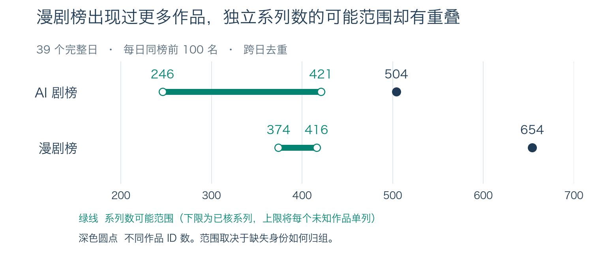

# 作品榜还是系列榜？红果短剧榜单中的系列集中与表观更替研究

*Titles or Franchises? Franchise Concentration and Apparent Turnover in Hongguo Short-Drama Rankings*

**Business Analytics 本科 FYP 讨论稿 · 2026 年 11 月 21 日**

**主问题**　同一张红果榜，如果按单部作品和按平台可识别的系列分别统计，关于“有多少项目在竞争”“头部占位是否集中”“每天进来多少新项目”的判断，会改变多少？这里的“系列榜”指研究者将原榜席位按系列归组后做的统计。本文不另排一张面向用户的榜，也不假设内容公司固定要看多少部作品。

**研究价值**　市场分析师用上榜作品数评估内容供给的广度，用入榜次数评估竞争项目的流动，这两个用途对应不同的计数单位。红果的作品 ID 能够分别标识同系列的多个季。下面的结果有三种形式：有的比较能得到明确方向，有的只能给出范围，有的在剔除单一系列后会改变方向。三种都比笼统地说“去重有影响”更有业务含义。

## RQ1　以作品或系列计数，哪个榜的上榜项目更广、席位更集中？

在 39 个四榜均完整的日期上，分别取各榜前 100 个位置，同一天的同一席位权重相同。跨日去重后的结果如下。

| 39 日内至少出现过一次 | AI 剧榜 | 漫剧榜 |
|---|---:|---:|
| 不同作品 ID | 504 | 654 |
| 有可核组号的作品 ID | 329 | 612 |
| 这些作品对应的已核系列 | 246 | 374 |
| 组号仍未知的作品 ID | 175 | 42 |
| 上榜系列数可能范围 | **246–421** | **374–416** |

按作品，漫剧明确多 150 部。若暂把每个未知作品都视为独立项目，换成系列后会得到 AI 421、漫剧 416，名次反转。但是两榜真实系列数的可能范围重叠。**能够确认的是漫剧榜上的作品更广；关于哪个榜覆盖更多系列，目前下不了同样明确的判断。** 下界让未知作品全部归入已知组，上界让其各属一个新组。区间以已核官网或历史组号正确、不同组号分别代表不同平台系列为前提。它是身份信息给出的范围，不是统计置信区间，也不等同于原著 IP 数。[完整表](concentration/concentration_summary.csv) · [可展示的图](作品数与系列数.png)

**广度与集中度也要分开。** 在未知作品各计一组的口径下，AI 榜每天平均有 87.92 组，漫剧榜 87.18 组。若让占多个席位的系列有相应权重，日均“等效系列数”分别为 **59.03 和 76.91**。例如，若 100 席由 50 个系列平分，等效数就是 50；同样 50 个系列中，若一个拿走一半位置，等效数会明显更小。计算取各组席位占比平方和的倒数，先逐日算再取平均。组数回答覆盖面，等效数回答席位分得有多均匀。按作品算、且每天每个作品恰占一席时，前百的日等效作品数恒为 100；这一点属于算式的性质。[逐日计算与不同榜深](concentration/daily_concentration.csv) · [有效数量的经典测度](https://journals.sagepub.com/doi/10.1177/001041407901200101)

## RQ2　榜单换进了新作品，实际换进了什么？

将连续两个完整自然日的同一张榜、同一深度做比较。这里有 37 对日期。作品昨天在排名范围外、今天在范围内，计一次“进入”。同一个 ID 以后退出再进入，可以再次计数。下表五类互斥，横向相加等于作品进入次数。

| 前百，37 对连续日期 | 作品进入 | 原有系列内部换位 | 原有系列净添席位 | 所属已核系列在本窗口同榜首次见到 | 所属已核系列离开后回归 | 系列身份未知 |
|---|---:|---:|---:|---:|---:|---:|
| 综合榜 | 541 | 8 | 41 | 264 | 111 | 117 |
| 真人榜 | 265 | 2 | 1 | 33 | 9 | 220 |
| AI 剧榜 | 404 | 5 | 28 | 175 | 45 | 151 |
| 漫剧榜 | 548 | 13 | 69 | 283 | 149 | 34 |

这些列都以**进入的作品或席位**计数。例如漫剧榜的 283 次首次观察类作品进入，对应 282 次已核系列首次出现；149 次回归类作品进入，对应 147 次已核系列回归。同一天同系列两季一起进来，作品可以记两次，系列只记一次。未核组号的 34 次单列。原来 35 日的 485 次作品进入也完全复现，原先识别出的 75 次既有系列入席可拆成 **13 次换位和 62 次净增**。[四榜、三档榜深汇总](turnover/turnover_summary.csv) · [逐组逐日账本](turnover/entry_group_ledger.csv)

| 漫剧榜的真实例子 | 作品口径 | 系列口径 |
|---|---|---|
| 10 月 22 日，《太玄胎珠传》第十六季退出，第十七季进入 | 一个作品进入 | 同系列原占一个席位，次日仍占一个，发生换位 |
| 10 月 15 日，《剑神归来：我和驴子的十万年》第一季仍在，第三季进入 | 一个作品进入 | 同系列从一个席位增至两个，原来的季仍然在榜 |
| 11 月 7 日，《谁让这个文盲修仙的》第五、第六季一起回到前百 | 两个作品进入 | 一个已经在观察期出现过的系列回归 |

“换位”是名单上同组进出数量的配对。某组同日进两季退一季，最多记一席换位、一席净增。没有证据表明平台有意用某一季替换某一季。这里的“首次”仅指从本次观察开始以来首次在这张榜的这个深度看见。10 月 31 日虽然有两个前百榜单各缺一席，当天真实出现的记录可以证明“曾经见过”，涉及该日的日对不进入主要更替分母。[可核实例](turnover/examples.csv)

**新进作品数会下降多少？** 漫剧榜 548 次入榜中，82 次来自前一日已经在榜的系列，另有 3 次属于多季同日进入一个此前缺席的系列时多出的席位。即使暂时把所有身份未知的作品都算独立，系列入榜事件也最多只有 **463 次**。进一步把未知系列可靠地连起来，系列进入次数只可能维持或降低。463 次包括观察期首次、回归及仍待判定的身份，不能解读成 463 个全新的市场项目。[逐日核算](turnover/paired_days.csv)

**更替速度一定变慢吗？** 用 Jaccard 距离测量相邻两天有多不同：仅在其中一天出现的对象数，除以两天合起来出现过的对象数。39 日内、前百、未知各单列时，漫剧榜按作品为 **25.62%**，按系列为 **24.67%**；AI 榜方向相反，从 **19.61% 升至 20.48%**。原因在于合并会同时改变分子和分母，一个持续在榜的大系列可合并掉许多每天都没变的作品。去掉《持械入宋》后，AI 榜按作品为 **21.11%**、按系列为 **20.69%**。这说明“作品口径一定高估更替速度”不宜写入假设的结论部分。所测均为相邻两天的成员变化，排名第 30 上升到第 3 而成员相同，不计成员更替。[去头部后的更替比较](turnover/dominant_series_turnover.csv)

在榜深上也存在一层容易混淆的变化。AI 榜 114 次作品进入前二十，其中 **86 次**是同一作品昨天已经在该榜第 21–100 名；另有 10 次虽未见同一作品，但昨天前百已见同系列另一部。在漫剧榜，134 次作品进入前二十，对应数为 43 和 28。由榜内上升过线与首次进入榜单，是两种不同的业务信号。[榜深门槛核验](threshold_entries.csv)

## RQ3　这些差别能否由少数系列或组号缺失解释？

**超级系列的贡献可直接点数。** 每个系列当日的额外席位等于已确认同组的作品数减一，最低取零。39 日前百，AI 榜最大系列《持械入宋》贡献已确认额外席位的 **286/471（60.7%）**；漫剧榜最大系列贡献 **45/500（9.0%）**。旧 35 日对应 **246/410（60.0%）** 和 **45/461（9.8%）**。这些分母均为识别出的额外席位，不能换成所有席位、播放或收入。两榜最大系列分别有 11 部和 5 部作品已逐项核对官网组号和剧名。剔除各榜最大系列、保留原榜深、不凭空递补后，日均等效系列数变成 AI 82.71、漫剧 77.47；原来 AI 更集中的排序随剔除条件改变。[分时段、分榜深、剔除头部结果](concentration/concentration_summary.csv) · [冠军系列作品页逐项核对](identity/largest_group_page_checks.csv)

**缺组号会动摇多大程度？** AI 前百可核组号的席位为 68.3%，漫剧为 93.7%。同一期间，真人榜只有 18.4%，据此比较真人与漫剧的真实集中程度尤其困难。题名与简介逐对初读后，有两组此前漏连的漫剧具有较强文本依据，包括《野骨也成，绕指柔》与其第四季。将两组作为候选补连，漫剧确认及假设合并后的额外席位从 500 增到 512，头部份额由 9.0% 变为 8.8%。这是有依据的敏感性情景，仍待独立人类核验。若允许两榜的未知作品同时作极端归组，甚至可以构造出相反排序。因此对**已识别系列**可以定量，对**所有真实系列**只能附条件陈述。正式研究应优先查跨多日、占多个榜位且身份未明的作品，让两位编码者独立复核，公开无法判定的案例。[候选核验清单](identity/plausible_review_pairs.csv) · [未知身份的数学边界](identity/missing_outer_bounds.csv) · [跨日归组一致的极端情景](identity/feasible_extreme_stress.csv)

同样的两对候选补连也能检验 RQ2。漫剧榜进入的作品中，可关联昨天在榜系列的事件从 **82/548（15.0%）** 增到 **84/548（15.3%）**。在有文本依据的这次修正里，结论变化很小；35 日旧窗对应从 75/485 增到 77/485。两对候选只覆盖已找到的漏配，不能据此推断所有未知均有相同分布。[补连前后的动态计数](identity/plausible_turnover.csv)

## 怎么向导师定位贡献

DataEye 对红果 AI 剧和漫剧的九月报告已经描述多个季同时上榜，列举过一个系列有 15 季在榜的案例。Ouyang 的 *HongguoTrending*（2026，预印本）用小时级榜单衡量成员更替，并比较红果网页和客户端的可见内容。这两项工作分别覆盖了“系列占位”和“榜单更替”。本研究用**同一批原始榜位**同时按作品、平台系列计量，将新增拆成换位、扩席、回归和观察内首次，并检验哪一种商业判断经得起身份缺失。这是测量设计与红果数据上的贡献。现有检索可用于说明相对这两项研究的增量，不足以主张世界首次。[DataEye 原文](https://www.jiemian.com/article/15210914.html) · [Ouyang 原文](https://arxiv.org/html/2611.19351v1)

**结论能用到哪里。** 内容公司做竞品简报时，上榜作品数可以说明有哪些制作项目露面。若要判断有多少独立的在榜系列，须另报组号覆盖率和系列数范围。把每次进入前二十都当成发现新竞争者，也会把原榜作品上升和续季扩席混进来。结果只描述四张红果网页榜、2026 年 10 月 13 日至 11 月 21 日的每日快照。现有数据缺未上榜供给、逐剧曝光、观众与财务指标。系列编号对应平台产品关系，不能替代版权所有者或生产公司；榜位也不等于观众份额。个人化推荐、投流效果或做续季的投资收益都需要其他数据才能估计。

**开题判断。** 建议将 RQ2 的作品进入分解作为主实证，RQ1 用于解释为什么要区别两种计数，RQ3 检查结论在什么条件下仍成立。增加到 60–90 个完整日和第二段独立时窗是后续验证目标。若扩展后更替差异很小，可以报告哪类榜单和深度对分析单位不敏感。如果跨榜排序一直受身份缺失影响，应保留区间，专注于能复核的换位、扩席和回归。日对并不独立，样本量按 39 个完整日、37 对相邻日说明；正式稿可按自然周分段、做留周复算，避免把每个席位当成一次独立实验。

**证据状态。** VERIFIED 为当日榜位、文中算例、统计量、官方作品页连接与先前文献研究范围。UNVERIFIED 为未知组的真实归属、未观察窗口中的表现和对制作投资的实际影响。AUTHOR_INPUT_NEEDED 为导师是否认可以平台季组作为主要业务对象，以及后续是否能安排独立身份核验。原监测名单比较可作为另一个应用实例，不承担本文的任何主要论证。
